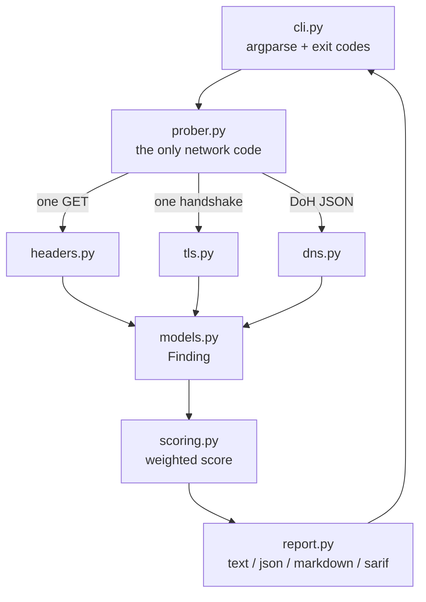

# posturekit

**One command that grades the external security posture of a host you own — headers, cookies, TLS and DNS email authentication — with SARIF output for CI.**

[](https://github.com/samarpan-aree/posturekit/actions/workflows/ci.yml)
[](https://www.python.org/)
[](LICENSE)
[](tests/)
[](pyproject.toml)
[](docs/ARCHITECTURE.md)

Most posture scanners check six headers and stop. That misses the two failures
that actually get sites compromised: a session cookie without `HttpOnly`, and a
domain with no DMARC record that anyone on the internet can spoof. `posturekit`
checks all four layers in a single pass and tells you the exact fix for each
finding.

```
$ posturekit github.com

posturekit 1.0.0 - https://github.com

5 finding(s) to fix

  [HIGH    ] Content Security Policy (csp)
             Policy present but weakened by: 'unsafe-inline'.
             fix: Serve a Content-Security-Policy with default-src 'self', nonce- or
             hash-based script-src, and no 'unsafe-inline' or 'unsafe-eval'.

  [MEDIUM  ] Cookie HttpOnly flag (cookie-httponly)
             Cookie(s) reachable from JavaScript: _octo.
             fix: Add HttpOnly to session and auth cookies so injected script cannot read them.

  [MEDIUM  ] SPF policy (spf)
             Record terminates with ~all rather than -all, so unauthorised
             senders are marked, not rejected.
             fix: Publish exactly one SPF record ending in -all, and stay within 10 DNS lookups.

Score 87/117 (74/100, grade C)
```

Real output from a live run, not a mock-up.

## What it checks

| Layer | Checks | Weight |
| --- | --- | --- |
| **Transport** | TLS version (rejects 1.0/1.1 even if a higher one is negotiated), certificate expiry window, hostname match, chain trust | 40 |
| **Headers** | HSTS length and `includeSubDomains`, CSP strength, clickjacking, `nosniff`, Referrer-Policy, Permissions-Policy, COOP, version disclosure | 47 |
| **Cookies** | `Secure`, `HttpOnly`, `SameSite` — per cookie, by name | 10 |
| **DNS** | SPF (single record, `-all`, RFC 7208 lookup budget), DMARC policy, CAA | 20 |

Eighteen checks total, each contributing its own weight, each carrying a
remediation string. A finding is never allowed to report a problem without
saying what to do about it.

## Install

```bash
pip install git+https://github.com/samarpan-aree/posturekit.git
```

Zero runtime dependencies — standard library only. That is a deliberate
constraint: a security tool you install into a locked-down environment should
not drag in a dependency tree you then have to audit.

## Usage

```bash
posturekit example.com                    # human-readable report
posturekit example.com -f json            # machine-readable
posturekit example.com -f markdown -o report.md
posturekit example.com -f sarif -o posture.sarif
posturekit example.com -g B               # exit 1 unless grade is B or better
posturekit example.com --skip dns         # skip a layer
```

### As a CI gate

Exit codes are stable: `0` met the grade threshold, `1` fell below it, `2` was a
usage problem. So a workflow step is three lines:

```yaml
- name: Security posture
  run: |
    pip install git+https://github.com/samarpan-aree/posturekit.git
    posturekit ${{ vars.PRODUCTION_HOST }} -g B
```

### Findings in GitHub code scanning

SARIF output uploads directly, so a failing check becomes an annotation on the
PR that caused it:

```yaml
- run: posturekit staging.example.com -f sarif -o posture.sarif
- uses: github/codeql-action/upload-sarif@v3
  with:
    sarif_file: posture.sarif
```

## Architecture



The design rule that makes this testable: **every check module is pure.** It
receives already-collected data — a header mapping, a `TlsProbe`, a list of TXT
records — and returns `Finding` objects. No sockets outside `prober.py`. That is
why 100 tests run in under a second with no network and no fixtures.

Weights live on the findings themselves, so `score()` is one line: earned weight
is the sum of passed weights. Adding a check widens the denominator
automatically, with no central table to keep in sync.

Full detail in [docs/ARCHITECTURE.md](docs/ARCHITECTURE.md).

## Safety and ethical use

This is a **defensive** tool. It reads what a server already sends to any
anonymous visitor and grades it. No exploitation, no injection, no credential
guessing, no crawling, no port scanning, no subdomain enumeration.

**Only scan hosts you own or have written authorisation to test.** Private,
loopback and reserved addresses are refused unless you pass `--allow-private`,
which exists for auditing your own internal estate.

Report vulnerabilities in this project privately — see [SECURITY.md](SECURITY.md).

## Roadmap

- [x] Header, cookie, TLS and DNS checks with weighted scoring
- [x] SARIF 2.1.0 output for GitHub code scanning
- [x] Grade-threshold gating in CI
- [ ] HSTS preload list membership check
- [ ] DKIM selector discovery and key-length validation
- [ ] `--fail-on critical` for severity-based gating
- [ ] Multi-host batch mode from a file, with a summary table
- [ ] Baseline mode: report only findings new since a stored snapshot
- [ ] HTML report with a per-layer breakdown chart

## License

MIT — see [LICENSE](LICENSE).
